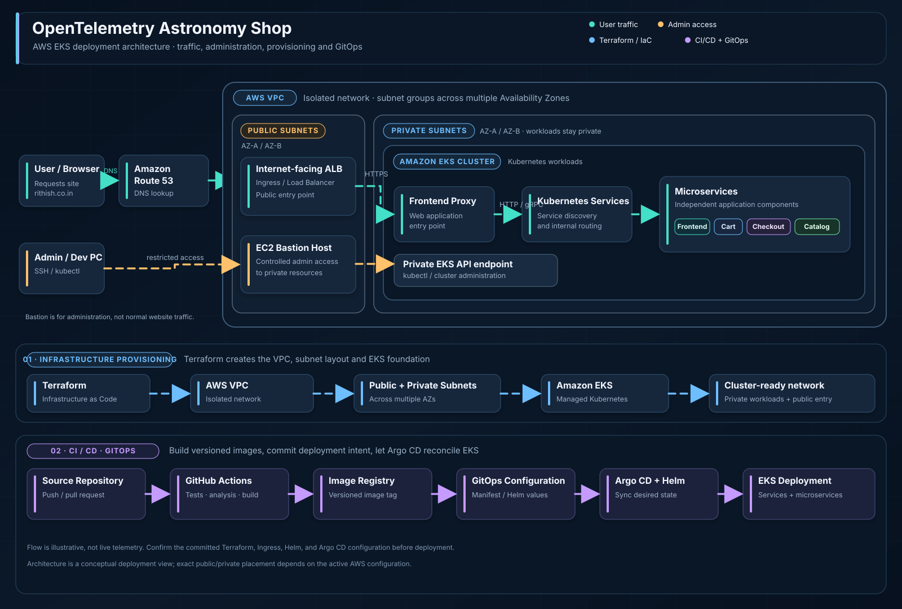

# OpenTelemetry Astronomy Shop on AWS EKS

A DevOps learning project based on the OpenTelemetry Astronomy Shop Demo, a microservices-based e-commerce application. I used it to practise Docker, Kubernetes, AWS networking, Terraform, Helm, GitHub Actions, Argo CD, and custom-domain routing.

> **Project note:** This repository is a fork and deployment adaptation of the upstream OpenTelemetry Demo. The application itself is the Astronomy Shop demo; my work focuses on the DevOps infrastructure and delivery workflow around it. See the credits below.

## Animated Deployment Architecture



This animated diagram gives an overview of how the application is intended to be exposed and deployed on AWS. The moving arrows indicate the direction of each workflow.

- **Application traffic (green):** User / Browser → Amazon Route 53 → internet-facing load balancer / Ingress → Frontend Proxy → Kubernetes Services → Astronomy Shop microservices.
- **Administrative access (amber):** Admin / Dev PC → EC2 Bastion Host → private EKS API endpoint. The bastion is for controlled administration, not normal website traffic.
- **Infrastructure provisioning (blue):** Terraform → AWS VPC → public and private subnets across multiple Availability Zones → Amazon EKS.
- **CI/CD and GitOps (purple):** Source Repository → GitHub Actions checks and image build → Container Registry → GitOps configuration → Argo CD + Helm → EKS workloads.

> **Architecture note:** This is an illustrative architecture diagram, not live telemetry. The Terraform modules, Helm chart, and Argo CD Application configuration used in my deployment are not currently committed to this branch, so the complete AWS deployment is not reproducible from this repository alone. The precise subnet and load-balancer setup must be confirmed against the active AWS configuration.

## Project overview

The Astronomy Shop simulates an online store for astronomy-related products such as telescopes. It consists of multiple services written in different languages and communicating through protocols such as gRPC, HTTP, and TCP. The service architecture of the application is distinct from the AWS deployment architecture shown above.

## What I built and practised

- **Docker:** Built and worked with service-specific Dockerfiles and multi-stage builds, separating build-time dependencies from runtime artifacts.
- **Kubernetes:** Worked with Deployments, Services, and ingress configuration for the microservices. Kubernetes manifests are present under `kubernetes/`.
- **Helm:** Used Helm to install, manage, upgrade, and uninstall Kubernetes releases in my deployment environment. The Helm chart is not currently committed to this branch.
- **AWS infrastructure with Terraform:** Built a VPC/EKS environment with public and private subnets across multiple Availability Zones. The Terraform source files used for that environment are not currently committed here.
- **Terraform remote state:** Practised storing Terraform state in S3 and locking state through DynamoDB in the setup I used. The corresponding backend configuration is not included in this branch.
- **Cluster access:** Used an EC2 bastion host to access private resources and administer the EKS environment.
- **Ingress and domain routing:** Configured ingress-based routing toward the frontend proxy and Route 53 DNS for `rithish.co.in` in my environment. The AWS DNS and ingress resources are environment-specific.
- **CI with GitHub Actions:** The committed workflow currently targets the Product Catalog service for build/test, quality checks, and container-image steps. It is not yet a complete CI pipeline for all application services.
- **CD with Argo CD and Helm:** Practised a GitOps delivery flow with Argo CD and Helm. The Argo CD Application and Helm chart configuration are not currently committed, so that part of the deployment cannot be reproduced from this repository alone.

## Architecture

The high-level deployment flow I practised is shown below. Some AWS and GitOps configuration represented here is not currently committed to this repository.

```text
Developer pushes code
        |
        v
GitHub repository
        |
        v
GitHub Actions (CI)
  - checkout
  - tests and quality checks
  - build container image
  - push image to registry
        |
        v
Updated deployment configuration in Git
        |
        v
Argo CD + Helm (CD / GitOps)
        |
        v
Amazon EKS cluster in private subnets
        |
        v
Kubernetes Services -> Frontend Proxy -> Astronomy Shop
        ^
        |
Ingress / load balancer
        ^
        |
Route 53 DNS -> rithish.co.in
```

### AWS network layout

- **VPC:** Isolated network for the deployment.
- **Public subnets:** Used for public-facing infrastructure and the bastion host, according to the deployment setup.
- **Private subnets:** Used for the EKS worker capacity and application workloads.
- **Multiple Availability Zones:** Subnets were spread across more than one AZ for the intended network layout.
- **Amazon EKS:** Runs the microservices as Kubernetes workloads.
- **Amazon Route 53:** Hosts DNS records for the custom domain.

This is a learning deployment, not a claim of production readiness. Before using it for production, review IAM permissions, network exposure, secrets handling, TLS, autoscaling, backups, observability, costs, and disaster recovery.

## Technology stack

| Area | Tools |
| --- | --- |
| Cloud | AWS |
| Infrastructure as Code | Terraform |
| Containerization | Docker, multi-stage Dockerfiles |
| Orchestration | Kubernetes, Amazon EKS |
| Kubernetes packaging | Helm |
| Continuous Integration | GitHub Actions |
| Continuous Delivery / GitOps | Argo CD |
| Networking and DNS | VPC, public/private subnets, Ingress, Route 53 |
| Terraform state | Amazon S3 and DynamoDB locking (as configured in my setup) |
| Application | OpenTelemetry Astronomy Shop Demo |

## Repository structure

Important committed paths include:

- `src/` — application microservices and source code.
- `kubernetes/` — Kubernetes workload manifests and Service/Ingress configuration.
- `.github/workflows/ci.yaml` — GitHub Actions workflow.
- `docker-compose.yml` — local multi-container demo setup.
- `docker-compose.minimal.yml` — reduced local demo configuration.

**Reproducibility gap:** The current `main` branch does not contain Terraform modules, a Helm chart, or Argo CD Application manifests. Add the actual files from your deployment environment if you want others to recreate the full AWS/EKS deployment from this repository. Do not add placeholder files that do not match the environment you tested.

## CI/CD workflow

The delivery flow I practised is:

1. A code change is submitted through GitHub.
2. GitHub Actions runs the configured build, test, and code-quality steps.
3. A container image is built and pushed to a registry when the workflow is configured and credentials are available.
4. The deployment configuration references the intended image version.
5. Argo CD reconciles the desired Kubernetes state from Git using manifests or Helm.

**What the checked-in workflow currently does:** `.github/workflows/ci.yaml` triggers on pull requests to `main` and focuses on the Product Catalog service. The Argo CD and Helm configuration described above is not in this branch, so do not treat the current repository as a fully reproducible end-to-end CI/CD setup yet.

Use immutable image tags (such as a commit SHA or run-specific tag) rather than relying only on `latest`. Store real registry/AWS credentials in GitHub Secrets or use identity-based access. Do not commit real credentials or private keys.

## Key things I learned

- How multi-stage Dockerfiles reduce the runtime image to the artifacts and libraries actually needed.
- How a multi-service application is modelled with Kubernetes Deployments and Services.
- How Helm simplifies installation, upgrades, and removal of Kubernetes applications.
- How VPCs, public/private subnets, Availability Zones, and bastion access fit into an EKS deployment.
- How Terraform remote state and state locking help coordinate infrastructure changes.
- How ingress rules and DNS records work together to expose an application through a custom domain.
- How CI image building and GitOps-based delivery separate application packaging from cluster reconciliation.
- How to debug real deployment problems involving networking, load balancer provisioning, IngressClass ownership, DNS, Terraform state, and Kubernetes resources.

## Running the demo locally

For local development, start with the upstream OpenTelemetry Demo instructions rather than assuming the AWS deployment configuration is portable:

- [OpenTelemetry Demo repository](https://github.com/open-telemetry/opentelemetry-demo)
- [Docker deployment documentation](https://opentelemetry.io/docs/demo/docker_deployment/)
- [Kubernetes deployment documentation](https://opentelemetry.io/docs/demo/kubernetes_deployment/)

The AWS deployment requires your own AWS account, IAM permissions, Terraform variables, DNS configuration, registry credentials, and Kubernetes tooling. Review the configuration before applying it. Cloud resources can incur charges.

## Screenshots

Add screenshots you have committed to this repository, then link them using their exact case-sensitive paths. Example:

```markdown


```

GitHub image links return 404 when the referenced file is not committed on the branch at that path. Confirm the file exists in the repository before adding it here.

## Credits and references

- **Application:** [OpenTelemetry Demo](https://github.com/open-telemetry/opentelemetry-demo)
- **DevOps learning reference:** [Abhishek Veeramalla's ultimate-devops-project-demo](https://github.com/iam-veeramalla/ultimate-devops-project-demo)
- **My repository:** [dugutarithish/ultimate-devops-project-demo](https://github.com/dugutarithish/ultimate-devops-project-demo)

This repository builds on upstream open-source work. Credit original authors and retain the applicable license and attribution notices. My contribution described here is the infrastructure, deployment, and CI/CD learning and customisation performed for this environment.
